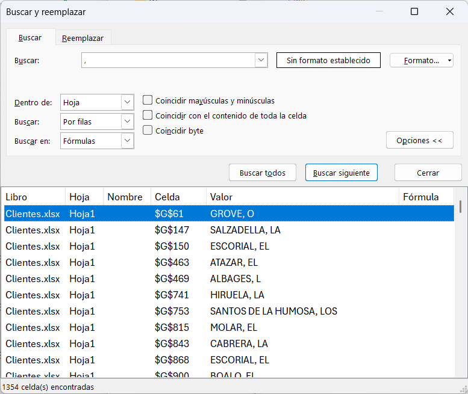
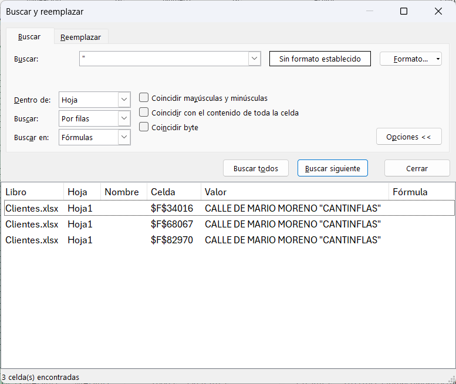
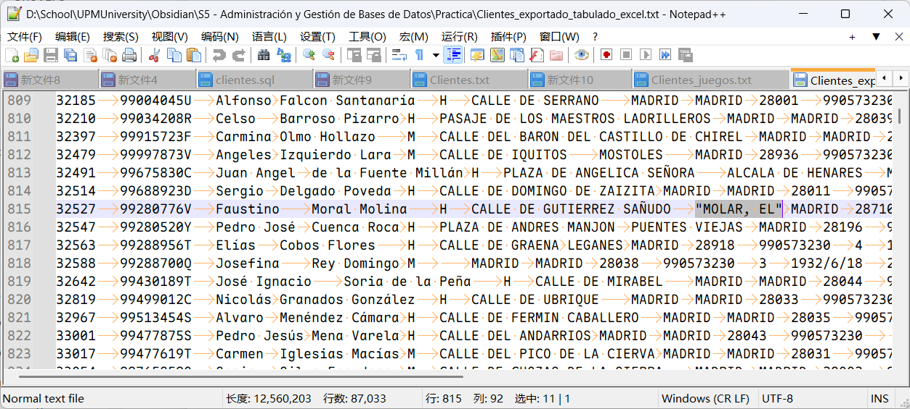
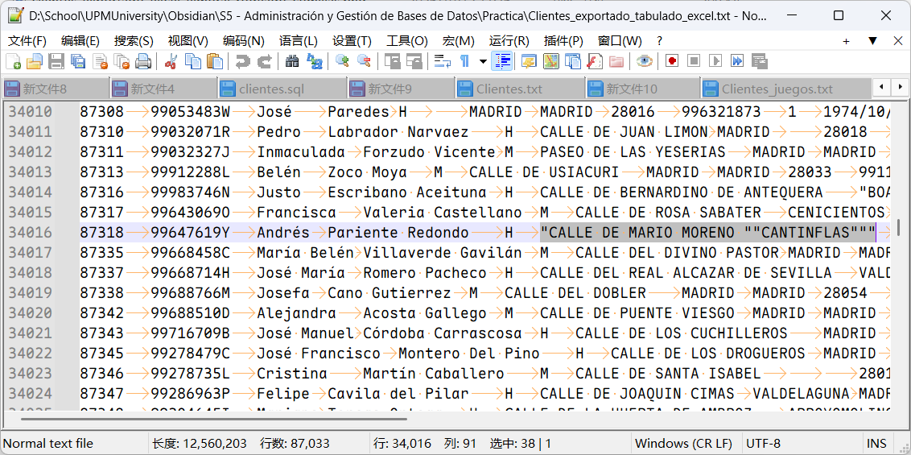
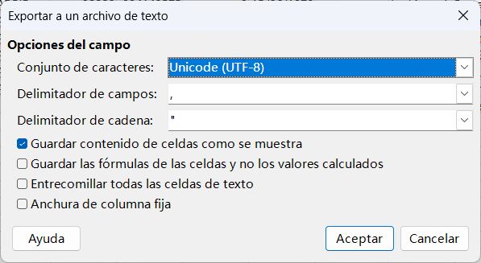
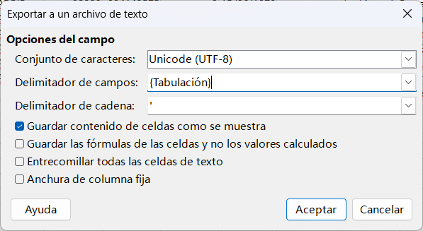
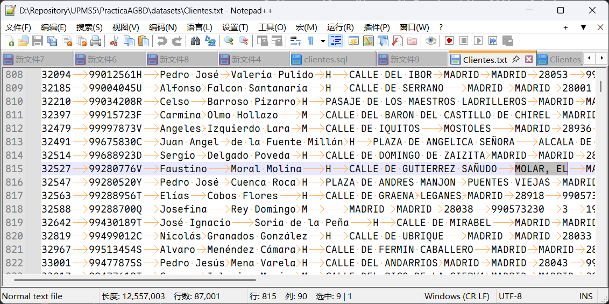
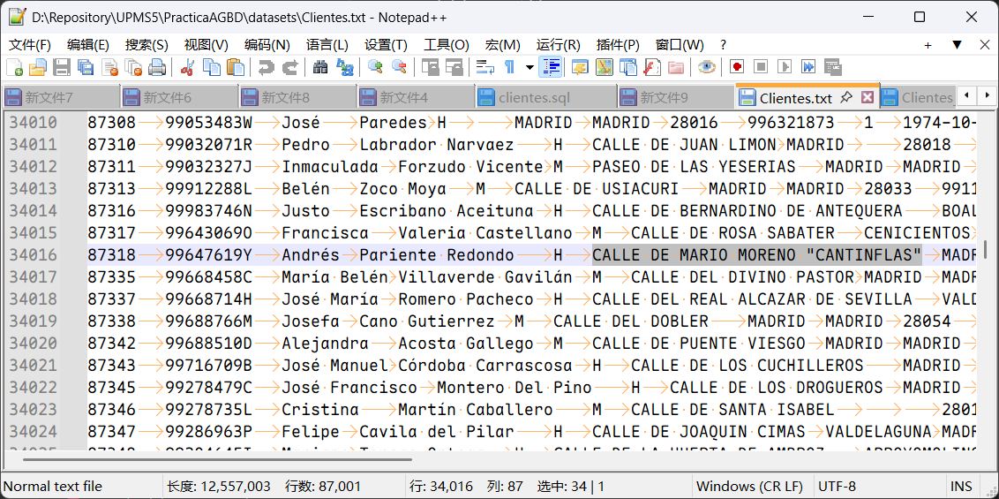

## Preparación del entorno

Iniciamos la Práctica creando el contenedor de Docker donde almacenaremos la imagen de MySQL para mantenerla aislada del sistema. Lo haremos en el puerto 3307, ya que más adelante, MariaDB usará el 3306 por predeterminado y esto podría borrarnos la base de datos de MySQL al pisarse una con la otra (ya nos ha pasado).
Comando de creación:
 ```bash 
docker run --name agbd -e MYSQL_ALLOW_EMPTY_PASSWORD=yes -p 3307:3306 -d mysql:8.0
 ```

Una vez hecho esto podemos tanto conectarnos a nuestro servidor de MySQL por MySQL Workbench como pasar ficheros .sql al contenedor y hacer source con el servicio de MySQL iniciado para ejecutar las querys (preferible hacer esto para la inyección de datos, ya que se ejecuta en un entorno que no está capado).

# Parte 1: Creación y carga de la Base de Datos
## 1A Creación Base  de Datos
```sql
CREATE DATABASE IF NOT EXISTS PracABD1
	CHARACTER SET = utf8mb4;
```
## 1B Borrado Base de Datos
```sql
DROP DATABASE IF EXISTS PracABD1;
```
## 2A Creación Tablespaces
```sql
CREATE TABLESPACE TBLS_clientes
	ADD DATAFILE 'DF_clientes.ibd'
	ENGINE = InnoDB;

CREATE TABLESPACE TBLS_juegos
	ADD DATAFILE 'DF_juegos.ibd'
	ENGINE = InnoDB;

CREATE TABLESPACE TBLS_clientesjuegos
	ADD DATAFILE 'DF_clientesjuegos.ibd'
	ENGINE = InnoDB;
```
## 2B Borrado Tablespaces
```sql
DROP TABLESPACE TBLS_clientes;
DROP TABLESPACE TBLS_juegos;
DROP TABLESPACE TBLS_clientesjuegos;
```

## 3A Creación Tablas

Para tabla clientes
```sql
CREATE TABLE Clientes (
	ClienteID		INTEGER		NOT NULL,
	DNI				CHAR(9)		NOT NULL,
	Nombre			VARCHAR(20)	NOT NULL,
	Apellidos		VARCHAR(30) NOT NULL,
	Genero			CHAR(1),
	Direccion		VARCHAR(60),
	Localidad		VARCHAR(50),
	Provincia		VARCHAR(30),
	CodPostal		INTEGER, /* Podría ser CHAR(5) si se transforma */
	Telefono		INTEGER, /* Podría ser CHAR(9) si se transforma */
	Canal			TINYINT, /* Podría ser un ENUM */
	FechaNacimiento	DATE,
	FechaContacto	DATE,
	Email			VARCHAR(60) /* Transformar acentos y ñ */
)
ENGINE = InnoDB
TABLESPACE = TBLS_clientes;
```

Para tabla juegos
```sql
CREATE TABLE Juegos (
	JuegoID			INTEGER 	NOT NULL,
	Titulo			VARCHAR(32)	NOT NULL,
	Consola			VARCHAR(12)	NOT NULL,
	Tamanio			INTEGER,
	Editor			VARCHAR(32)
)
ENGINE = InnoDB
TABLESPACE = TBLS_juegos;
```

Para tabla clientes_juegos
```sql
CREATE TABLE Clientes_Juegos (
    ClienteID      INT		NOT NULL,
    JuegoID        INT		NOT NULL,
    FechaAlquiler  DATE		NOT NULL,
    Comentarios    VARCHAR(500)
)
ENGINE = InnoDB
TABLESPACE = TBLS_clientesjuegos;
```

## 3B Borrado Tablas
```sql
DROP TABLE Clientes;
DROP TABLE Juegos;
DROP TABLE Clientes_Juegos;
```

## 4A Crear Claves Primarias
```sql
ALTER TABLE Clientes ADD PRIMARY KEY (ClienteID);
ALTER TABLE Juegos ADD PRIMARY KEY (JuegoID);
ALTER TABLE Clientes_Juegos ADD CONSTRAINT Clave_Clientes_Juegos PRIMARY KEY (ClienteID, JuegoID, FechaAlquiler);
```


## 4B Crear Claves Foráneas
```sql
ALTER TABLE Clientes_Juegos
ADD CONSTRAINT Clave_Clientes 
FOREIGN KEY (ClienteID) 
REFERENCES Clientes(ClienteID);

ALTER TABLE Clientes_Juegos
ADD CONSTRAINT Clave_Juegos
FOREIGN KEY (JuegoID) 
REFERENCES Juegos(JuegoID);
```
## 4C Eliminar Claves Primarias
```sql
ALTER TABLE Clientes DROP PRIMARY KEY;
ALTER TABLE Juegos DROP PRIMARY KEY;
ALTER TABLE Clientes_Juegos DROP PRIMARY KEY;
```
## 4D Eliminar Claves Foráneas
```sql
ALTER TABLE Clientes_Juegos DROP FOREIGN KEY Clave_Clientes;
ALTER TABLE Clientes_Juegos DROP FOREIGN KEY Clave_Juegos;
```


## 5 Creación de la Base de Datos

Para crear la estructura de la Base de datos ejecutamos los scripts anteriores en orden (1A, 2A, 3A, 4A, 4B)

## 6 Cargado de Datos
Para Clientes, requiere el documento separado por tabuladores `Clientes.txt` derivado del juego de datos `Clientes.xlsx`, el proceso para generar `Clientes.txt` se puede ver en el anexo al final del documento.

Si hace falta eliminar datos en la tabla `cliente` y función `normalizar_email`:
`TRUNCATE TABLE IF EXISTS clientes;`
`DROP FUNCTION IF EXISTS normalizar_email;`

```sql
DELIMITER $$
CREATE FUNCTION normalizar_email(
    email VARCHAR(60)
)
RETURNS VARCHAR(60)
DETERMINISTIC
BEGIN
    DECLARE resultado VARCHAR(60);
	SET resultado = email;

	-- Ññ -> Nn
	SET resultado = REPLACE(resultado, 'ñ', 'n');
	SET resultado = REPLACE(resultado, 'Ñ', 'N');

	-- A: acento agudo y grave
	SET resultado = REPLACE(resultado, 'á', 'a');
	SET resultado = REPLACE(resultado, 'à', 'a');
	SET resultado = REPLACE(resultado, 'Á', 'A');
	SET resultado = REPLACE(resultado, 'À', 'A');
	
	-- E: acento agudo y grave
	SET resultado = REPLACE(resultado, 'é', 'e');
	SET resultado = REPLACE(resultado, 'è', 'e');
	SET resultado = REPLACE(resultado, 'É', 'E');
	SET resultado = REPLACE(resultado, 'È', 'E');
	
	-- I: acento agudo y grave
	SET resultado = REPLACE(resultado, 'í', 'i');
	SET resultado = REPLACE(resultado, 'ì', 'i');
	SET resultado = REPLACE(resultado, 'Í', 'I');
	SET resultado = REPLACE(resultado, 'Ì', 'I');
	
	-- O: acento agudo y grave
	SET resultado = REPLACE(resultado, 'ó', 'o');
	SET resultado = REPLACE(resultado, 'ò', 'o');
	SET resultado = REPLACE(resultado, 'Ó', 'O');
	SET resultado = REPLACE(resultado, 'Ò', 'O');
	
	-- U: acento agudo y grave
	SET resultado = REPLACE(resultado, 'ú', 'u');
	SET resultado = REPLACE(resultado, 'ù', 'u');
	SET resultado = REPLACE(resultado, 'Ú', 'U');
	SET resultado = REPLACE(resultado, 'Ù', 'U');
	
	-- U con diéresis
	SET resultado = REPLACE(resultado, 'ü', 'u');
	SET resultado = REPLACE(resultado, 'Ü', 'U');

    RETURN resultado;
END $$
DELIMITER ;

LOAD DATA LOCAL INFILE "/path/to/Clientes.txt"
INTO TABLE clientes 
CHARACTER SET utf8mb4
FIELDS TERMINATED BY "\t"
LINES TERMINATED BY "\r\n"
(ClienteId, DNI, Nombre, Apellidos, @genero, @direccion, @localidad, @provincia, @codPostal, @telefono, @canal, @FechaNac, @FechaCont, @email)
SET
	Genero			= IF(@genero = '', NULL, @genero), -- Se puede mejorar con NULLIF
	Direccion		= IF(@direccion = '', NULL, @direccion),
	Localidad		= IF(@localidad = '', NULL, @localidad),
	Provincia		= IF(@provincia = '', NULL, REPLACE(@provincia, "", "")), -- Juego de dato fuente continene U+0081, quitar dicho caracter invisible
	CodPostal		= IF(@codPostal = '', NULL, @codPostal),
	Telefono		= IF(@telefono = '', NULL, @telefono),
	Canal			= IF(@canal = '', 0, @canal),
	FechaNacimiento	= IF(@FechaNac = '', NULL, STR_TO_DATE(@FechaNac, "%Y-%c-%e")),
	FechaContacto	= IF(@FechaCont = '', NULL, STR_TO_DATE(@FechaCont, "%Y-%c-%e")),
	Email			= IF(@email = '', NULL, normalizar_email(@email));
```

y hacemos las inserciones de los tres ficheros juegos de esta manera:

Para el de MegaDrive:
```sql
LOAD XML LOCAL INFILE '/home/querys/MegaDrive.xml'
INTO TABLE Juegos
ROWS IDENTIFIED BY '<game>'
(@imageNumber,@title, @publisher, @romSize)
Set
    JuegoID = @imageNumber+10000,
    Titulo = LEFT(@title, 32), 
    Consola = "MegaDrive",
    Editor = LEFT(@publisher, 32),
    Tamanio = @romSize;
```

Para el de Nintendo:
```sql
LOAD XML LOCAL INFILE '/home/querys/Nintendo.xml'
INTO TABLE Juegos
ROWS IDENTIFIED BY '<game>'
(@imageNumber,@title, @publisher, @romSize)
Set
    JuegoID = @imageNumber+12000,
    Titulo = LEFT(@title, 32), 
    Consola = "Nintendo",
    Editor = @publisher,
    Tamanio = @romSize;
```

Para el de GameBoy:
```sql
LOAD XML LOCAL INFILE '/home/querys/GameBoy.xml'
INTO TABLE Juegos
ROWS IDENTIFIED BY '<game>'
(@imageNumber, @title, @publisher, @romSize)
Set
    JuegoID = @imageNumber+15000,
    Titulo = LEFT(@title, 32), 
    Consola = "GameBoy",
    Editor = @publisher,
    Tamanio = @romSize;
```

Finalmente cargamos los alquileres de los clientes con los juegos. Este paso va a generar Warnings y Skipped, puesto que hay clientes que alquilan juegos que no existen, y juegos que son alquilados por clientes no existentes. Vamos a garantizar la coherencia dentro del base de datos, y hemos decidido que las entradas de alquileres de cliente fantasma o juego de fantasma no van a entrar en el base de dato.

```sql
LOAD DATA LOCAL INFILE "/home/querys/Clientes_juegos.txt"
INTO TABLE clientes_juegos
CHARACTER SET utf8mb4
FIELDS TERMINATED BY "\t"
LINES TERMINATED BY "\r\n"
(ClienteId, JuegoID, @fecha, Comentarios)
SET
    FechaAlquiler = STR_TO_DATE(@fecha, "%Y-%c-%e");
```


# Parte 2: Creación y Estudio de Índices

En el enunciado, parte 2: creación y estudios de índices se han propuesto los siguientes escenarios:

1A. Obtener el correo de un cliente a partir de su nombre y apellidos. Realiza las pruebas concretamente Ángeles del Nido, que es la clienta que están buscando en este momento. 

1B. Obtener el número de clientes de una determinada provincia. Realiza las pruebas con Lugo, que es la provincia en la que están valorando abrir mercado. 

1C. Obtener un listado que contenga el nombre completo y el correo electrónico de los clientes que hayan contactado mediante un determinado canal en cierto periodo de tiempo. Realiza las pruebas concretamente con el canal web y el periodo 2019, que se corresponde con los clientes a los que se les pretende ofrecer un descuento especial. 

1D. Obtener un listado de clientes que contenga su nombre completo y el título del videojuego o videojuegos que han alquilado durante los años 2019 y 2020, así como la fecha concreta en la que han alquilado cada juego. El listado debe estar ordenado por apellidos y contener solo clientes que sean de una determinada provincia. Realiza las pruebas con los clientes de Madrid, que es el mercado que se está analizando

1E. Realiza dos consultas que pienses que puedan ser de interés para la empresa y con las que puedas extraer alguna conclusión de interés relativa al uso de los índices
-  De interés: Localizar un cliente a partir de su DNI para el sistema de Login de la página web del alquiler
-  De interés: Obtener la cantidad de juegos publicados según su editorial y consola, o solo su editorial para análisis o estadística

Analizando, podemos elaborar la siguiente tabla

| N   | Obtener                                                                   | A partir del                       | Tabla                            | Obtener (Columna)                                                                 | A partir del (Columna)                            | Observación            |
| --- | ------------------------------------------------------------------------- | ---------------------------------- | -------------------------------- | --------------------------------------------------------------------------------- | ------------------------------------------------- | ---------------------- |
| 1   | Correo de un cliente                                                      | Nombre, apellidos                  | Clientes                         | Email                                                                             | Nombre, Apellidos                                 |                        |
| 2   | (Número de) Clientes                                                      | Provincia                          | Clientes                         | COUNT(\*)                                                                         | Provincia                                         |                        |
| 3   | Nombre completo cliente, Correo Electrónico                               | Canal en cierto periodo de tiempo  | Clientes                         | Nombre, Apellidos                                                                 | Canal, FechaContacto                              |                        |
| 4   | Nombre completo cliente, Título del videojuego, Fecha exacto del alquiler | Fecha (año) de alquiler, Provincia | Clientes, Juegos, Cliente_Juegos | Clientes.Nombre, Clientes.Apellidos, Juegos.Titulo, Clientes_juegos.FechaAlquiler | Clientes_juegos.FechaAlquiler, Clientes.Provincia | Ordenado por apellidos |
| 5   | ID del cliente                                                            | DNI cliente                        | Clientes                         | ClienteID                                                                         | DNI                                               |                        |
| 6   | Cantidad de juegos                                                        | Editorial, consola                 | Juegos                           | COUNT(\*)                                                                         | Editor, Consola                                   |                        |

## Creación de índices y sentencias de prueba
En la siguiente sección se indican las sentencias para la creación de índices y sentencias de prueba
### 1 Obtener email del cliente a partir de su nombre y apellidos
#### ✏️ Creación
```sql
CREATE INDEX idx_clientes_apellidos_nombre
ON Clientes (Apellidos ASC, Nombre); -- Reordenado para acelerar consulta N4
```
#### ⛔ Eliminación
```sql
DROP INDEX idx_clientes_apellidos_nombre
ON Clientes;
```
#### ✅ Prueba
```sql
SELECT Email
FROM clientes
WHERE
	Nombre LIKE "Ángeles"
	AND
	Apellidos LIKE "del Nido";
```
### 2 Obtener número de clientes a partir de su provincia
#### ✏️ Creación
```sql
CREATE INDEX idx_clientes_provincia
ON Clientes (Provincia);
```
#### ⛔ Eliminación
```sql
DROP INDEX idx_clientes_provincia
ON Clientes;
```
#### ✅ Prueba
```sql
SELECT COUNT(*)
FROM Clientes
WHERE
	Provincia LIKE 'Lugo';
```
### 3 Obtener nombres, apellidos, correo electrónico del cliente a partir de su canal y fecha de contacto
#### ✏️ Creación
```sql
CREATE INDEX idx_clientes_aniocontacto_canal
ON Clientes ((YEAR(FechaContacto)), Canal);
```
#### ⛔ Eliminación
```sql
DROP INDEX idx_clientes_aniocontacto_canal
ON Clientes;
```
#### ✅ Prueba
```sql
SELECT Nombre, Apellidos, Email
FROM Clientes
WHERE
	YEAR(FechaContacto) = 2019 -- Optimizar el año por si el formato textual de la fecha es distinto
	AND
	Canal = 1; -- Canal Web
```
### 4 Obtener nombre y apellidos, título del videojuego y fecha del alquiler a partir del fecha (año) del alquiler y provincia del cliente

#### ✏️ Creación
```sql
CREATE INDEX idx_clientes_juegos_anioalquiler
ON Clientes_juegos ((YEAR(FechaAlquiler)));
-- Clientes.Provincia ya está cubierto por idx_clientes_provincia
-- ORDER BY Clientes.Apellidos podría ser acelerado por idx_clientes_apellidos_nombre
```
#### ⛔ Eliminación
```sql
DROP INDEX idx_clientes_juegos_anioalquiler
ON Clientes_juegos;
```
#### ✅ Prueba
```sql
SELECT Clientes.Nombre, Clientes.Apellidos, Juegos.Titulo, Clientes_juegos.FechaAlquiler
FROM Clientes_juegos
	INNER JOIN Clientes ON Clientes_juegos.ClienteID = Clientes.ClienteID
	INNER JOIN Juegos ON Clientes_juegos.JuegoID = Juegos.JuegoID
WHERE
	YEAR(Clientes_juegos.FechaAlquiler) IN (2019, 2020)
	AND
	Clientes.Provincia LIKE "Madrid"
ORDER BY Clientes.Apellidos;
```
### 5 Obtener ID del cliente a partir de su DNI
#### ✏️ Creación
```sql
CREATE INDEX idx_clientes_dni
ON Clientes (DNI);
```
#### ⛔ Eliminación
```sql
DROP INDEX idx_clientes_dni
ON Clientes;
```
### ✅ Prueba
```sql
SELECT *
FROM Clientes
WHERE
	DNI LIKE "99158698F";
```
### 6 Obtener cantidad de juegos a partir del editorial y consola
#### ✏️ Creación
```sql
CREATE INDEX idx_juegos_editorial_consola
ON Juegos (editor, consola);
```
#### ⛔ Eliminación
```sql
DROP INDEX idx_juegos_editorial_consola
ON Juegos;
```
#### ✅ Prueba
```sql
SELECT Editor, Consola, COUNT(*) as cantidad_juegos FROM juegos
WHERE
	editor LIKE "Bandai"
	AND
	consola LIKE "MegaDrive"
GROUP BY Editor, Consola;
```
## Pruebas
Todas las sentencias usados aquí se ejecutará en **terminal**, excepto indicado por `Workbench:`.
### 2A Sin claves primarios ni foráneas
Antes de empezar las sentencias de prueba para cada sentencias de prueba, se ha ejecutado (4D y 4C, `borrado_claves_foraneas.sql` y `borrado_claves_primarias.sql`):
```sql
-- source borrado_claves_foraneas.sql
ALTER TABLE Clientes_Juegos DROP FOREIGN KEY Clave_Clientes;
ALTER TABLE Clientes_Juegos DROP FOREIGN KEY Clave_Juegos;
ALTER TABLE Clientes DROP PRIMARY KEY;
-- source borrado_claves_primarias.sql
ALTER TABLE Juegos DROP PRIMARY KEY;
ALTER TABLE Clientes_Juegos DROP PRIMARY KEY;
-- Quitar el índice restante de Clave_Juegos
DROP INDEX Clave_juegos ON Clientes_Juegos; -- Por cualquier razón el índice sigue ahí cuando se eliminan las claves foráneas
```
Una vez eliminado las claves primarias y foráneas, al ejecutar las sentencias de prueba, se obtienen los siguientes tiempos:

| Consulta | Nombre consulta                                                                                                                      | Tiempo de ejecución | Resultados retornados |
| -------- | ------------------------------------------------------------------------------------------------------------------------------------ | ------------------- | --------------------- |
| 1        | Obtener email del cliente a partir de su nombre y apellidos                                                                          | 0,03s               | 3                     |
| 2        | Obtener número de clientes a partir de su provincia                                                                                  | 0,03s               | 1                     |
| 3        | Obtener nombres, apellidos, correo electrónico del cliente a partir de su canal y fecha de contacto                                  | 0,03s               | 1666                  |
| 4        | Obtener nombre y apellidos, título del videojuego y fecha del alquiler a partir del fecha (año) del alquiler y provincia del cliente | 1,78s               | 9076                  |
| 5        | Obtener ID del cliente a partir de su DNI                                                                                            | 0,04s               | 1                     |
| 6        | Obtener cantidad de juegos a partir del editorial y consola                                                                          | Workbench: 3,359ms  | 1                     |
Observación, la consulta N6 se ejecuta en tan poco tiempo, que en el terminal directamente muestra 0,00s. Lo cual se utiliza Workbench para obtener el tiempo de consulta en ms.
### 2B Reactivando claves primarias y foráneas
Antes de empezar las sentencias de prueba para cada sentencias de prueba, se ha ejecutado (4A y 4B, `creacion_claves_primarias.sql` y `creacion_claves_foraneas.sql`):
```sql
-- source creacion_claves_primarias.sql
ALTER TABLE Clientes ADD PRIMARY KEY (ClienteID);
ALTER TABLE Juegos ADD PRIMARY KEY (JuegoID);
ALTER TABLE Clientes_Juegos ADD CONSTRAINT Clave_Clientes_Juegos PRIMARY KEY (ClienteID, JuegoID, FechaAlquiler);
-- source creacion_claves_foraneas.sql
ALTER TABLE Clientes_Juegos
ADD CONSTRAINT Clave_Clientes
FOREIGN KEY (ClienteID)
REFERENCES Clientes(ClienteID);

ALTER TABLE Clientes_Juegos
ADD CONSTRAINT Clave_Juegos
FOREIGN KEY (JuegoID)
REFERENCES Juegos(JuegoID);
```

| Consulta | Nombre consulta                                                                                                                      | Tiempo de ejecución | Resultados retornados | Cambio con respecto al apartado anterior |
| -------- | ------------------------------------------------------------------------------------------------------------------------------------ | ------------------- | --------------------- | ---------------------------------------- |
| 1        | Obtener email del cliente a partir de su nombre y apellidos                                                                          | 0,02s               | 3                     | -0,01s                                   |
| 2        | Obtener número de clientes a partir de su provincia                                                                                  | 0,01s               | 1                     | -0,02s                                   |
| 3        | Obtener nombres, apellidos, correo electrónico del cliente a partir de su canal y fecha de contacto                                  | 0,02s               | 1666                  | -0,01s                                   |
| 4        | Obtener nombre y apellidos, título del videojuego y fecha del alquiler a partir del fecha (año) del alquiler y provincia del cliente | 0,18s               | 9076                  | -1,60s                                   |
| 5        | Obtener ID del cliente a partir de su DNI                                                                                            | 0,04s               | 1                     | 0                                        |
| 6        | Obtener cantidad de juegos a partir del editorial y consola                                                                          | Workbench: 2,041ms  | 1                     | -1,138ms                                 |
Observación: la consulta N6 fluctúa un poco, pero en general sigue siendo el mismo tiempo que sin claves primarias/foráneas
### 2C Activando gradualmente los índices
Las índices creadas en cada apartado son las siguientes:

| Consulta | Nombre consulta                                                                                                                      | Nombre índice                      |
| -------- | ------------------------------------------------------------------------------------------------------------------------------------ | ---------------------------------- |
| 1        | Obtener email del cliente a partir de su nombre y apellidos                                                                          | `idx_clientes_apellidos_nombre`    |
| 2        | Obtener número de clientes a partir de su provincia                                                                                  | `idx_clientes_provincia`           |
| 3        | Obtener nombres, apellidos, correo electrónico del cliente a partir de su canal y fecha de contacto                                  | `idx_clientes_aniocontacto_canal`  |
| 4        | Obtener nombre y apellidos, título del videojuego y fecha del alquiler a partir del fecha (año) del alquiler y provincia del cliente | `idx_clientes_juegos_anioalquiler` |
| 5        | Obtener ID del cliente a partir de su DNI                                                                                            | `idx_clientes_dni`                 |
| 6        | Obtener cantidad de juegos a partir del editorial y consola                                                                          | `idx_juegos_editorial_consola`     |
**Asumiendo que los claves primarios y secundarios siguen activos, y los indices creados en los apartados previos siguen activos**
#### Obtener email del cliente a partir de su nombre y apellidos
Antes de activar el índice
```sql
EXPLAIN SELECT Email
FROM clientes
WHERE
	Nombre LIKE "Ángeles"
	AND
	Apellidos LIKE "del Nido";
```
```
+----+-------------+----------+------------+------+---------------+------+---------+------+-------+----------+-------------+
| id | select_type | table    | partitions | type | possible_keys | key  | key_len | ref  | rows  | filtered | Extra       |
+----+-------------+----------+------------+------+---------------+------+---------+------+-------+----------+-------------+
|  1 | SIMPLE      | clientes | NULL       | ALL  | NULL          | NULL | NULL    | NULL | 85884 |     1.23 | Using where |
+----+-------------+----------+------------+------+---------------+------+---------+------+-------+----------+-------------+
```

Activamos el índice `idx_clientes_apellidos_nombre` y verificamos que se utiliza el índice
```sql
CREATE INDEX idx_clientes_apellidos_nombre
ON Clientes (Apellidos ASC, Nombre);
```
```
+----+-------------+----------+------------+-------+-------------------------------+-------------------------------+---------+------+------+----------+-----------------------+
| id | select_type | table    | partitions | type  | possible_keys                 | key                           | key_len | ref  | rows | filtered | Extra                 |
+----+-------------+----------+------------+-------+-------------------------------+-------------------------------+---------+------+------+----------+-----------------------+
|  1 | SIMPLE      | clientes | NULL       | range | idx_clientes_apellidos_nombre | idx_clientes_apellidos_nombre | 204     | NULL |    3 |   100.00 | Using index condition |
+----+-------------+----------+------------+-------+-------------------------------+-------------------------------+---------+------+------+----------+-----------------------+
```

#### Obtener número de clientes a partir de su provincia

Antes de activar el índice
```sql
EXPLAIN SELECT COUNT(*)
FROM Clientes
WHERE
	Provincia LIKE 'Lugo';
```
```
+----+-------------+----------+------------+------+---------------+------+---------+------+-------+----------+-------------+
| id | select_type | table    | partitions | type | possible_keys | key  | key_len | ref  | rows  | filtered | Extra       |
+----+-------------+----------+------------+------+---------------+------+---------+------+-------+----------+-------------+
|  1 | SIMPLE      | Clientes | NULL       | ALL  | NULL          | NULL | NULL    | NULL | 85884 |    11.11 | Using where |
+----+-------------+----------+------------+------+---------------+------+---------+------+-------+----------+-------------+
```

Activamos el índice `idx_clientes_provincia` y verificamos que se utiliza el índice
```sql
CREATE INDEX idx_clientes_provincia
ON Clientes (Provincia);
```
```
+----+-------------+----------+------------+-------+------------------------+------------------------+---------+------+------+----------+--------------------------+
| id | select_type | table    | partitions | type  | possible_keys          | key                    | key_len | ref  | rows | filtered | Extra                    |
+----+-------------+----------+------------+-------+------------------------+------------------------+---------+------+------+----------+--------------------------+
|  1 | SIMPLE      | Clientes | NULL       | range | idx_clientes_provincia | idx_clientes_provincia | 123     | NULL |   20 |   100.00 | Using where; Using index |
+----+-------------+----------+------------+-------+------------------------+------------------------+---------+------+------+----------+--------------------------+
```

#### Obtener nombres, apellidos, correo electrónico del cliente a partir de su canal y fecha de contacto
Antes de activar el índice
```sql
EXPLAIN SELECT Nombre, Apellidos, Email
FROM Clientes
WHERE
	YEAR(FechaContacto) = 2019 -- Optimizar el año por si el formato textual de la fecha es distinto
	AND
	Canal = 1; -- Canal Web
```
```
+----+-------------+----------+------------+------+---------------+------+---------+------+-------+----------+-------------+
| id | select_type | table    | partitions | type | possible_keys | key  | key_len | ref  | rows  | filtered | Extra       |
+----+-------------+----------+------------+------+---------------+------+---------+------+-------+----------+-------------+
|  1 | SIMPLE      | Clientes | NULL       | ALL  | NULL          | NULL | NULL    | NULL | 85884 |    10.00 | Using where |
+----+-------------+----------+------------+------+---------------+------+---------+------+-------+----------+-------------+
```

Activamos el índice `idx_clientes_aniocontacto_canal` y verificamos que se utiliza el índice
```sql
CREATE INDEX idx_clientes_aniocontacto_canal
ON Clientes ((YEAR(FechaContacto)), Canal);
```
```
+----+-------------+----------+------------+------+---------------------------------+---------------------------------+---------+-------------+------+----------+-------+
| id | select_type | table    | partitions | type | possible_keys                   | key                             | key_len | ref         | rows | filtered | Extra |
+----+-------------+----------+------------+------+---------------------------------+---------------------------------+---------+-------------+------+----------+-------+
|  1 | SIMPLE      | Clientes | NULL       | ref  | idx_clientes_aniocontacto_canal | idx_clientes_aniocontacto_canal | 4       | const,const | 1666 |   100.00 | NULL  |
+----+-------------+----------+------------+------+---------------------------------+---------------------------------+---------+-------------+------+----------+-------+
```
#### Obtener nombre y apellidos, título del videojuego y fecha del alquiler a partir del fecha (año) del alquiler y provincia del cliente
Antes de activar el índice
```sql
EXPLAIN SELECT Clientes.Nombre, Clientes.Apellidos, Juegos.Titulo, Clientes_juegos.FechaAlquiler
FROM Clientes_juegos
	INNER JOIN Clientes ON Clientes_juegos.ClienteID = Clientes.ClienteID
	INNER JOIN Juegos ON Clientes_juegos.JuegoID = Juegos.JuegoID
WHERE
	YEAR(Clientes_juegos.FechaAlquiler) IN (2019, 2020)
	AND
	Clientes.Provincia LIKE "Madrid"
ORDER BY Clientes.Apellidos;
```
```
+----+-------------+-----------------+------------+--------+--------------------------------+--------------+---------+------------------------------------+------+----------+---------------------------------+
| id | select_type | table           | partitions | type   | possible_keys                  | key          | key_len | ref                                | rows | filtered | Extra                           |
+----+-------------+-----------------+------------+--------+--------------------------------+--------------+---------+------------------------------------+------+----------+---------------------------------+
|  1 | SIMPLE      | Juegos          | NULL       | ALL    | PRIMARY                        | NULL         | NULL    | NULL                               | 6252 |   100.00 | Using temporary; Using filesort |
|  1 | SIMPLE      | Clientes_juegos | NULL       | ref    | PRIMARY,Clave_Juegos           | Clave_Juegos | 4       | pracabd1.Juegos.JuegoID            |    4 |   100.00 | Using where; Using index        |
|  1 | SIMPLE      | Clientes        | NULL       | eq_ref | PRIMARY,idx_clientes_provincia | PRIMARY      | 4       | pracabd1.Clientes_juegos.ClienteID |    1 |    50.00 | Using where                     |
+----+-------------+-----------------+------------+--------+--------------------------------+--------------+---------+------------------------------------+------+----------+---------------------------------+
```
Observación: `Clave_Juegos` es el índice generado por la clave foránea entre `Cliente_Juegos` y `Juegos`.

Activamos el índice `idx_clientes_juegos_anioalquiler` y verificamos que se utiliza el índice
```sql
CREATE INDEX idx_clientes_juegos_anioalquiler
ON Clientes_juegos ((YEAR(FechaAlquiler)));
```
```
+----+-------------+-----------------+------------+--------+-------------------------------------------------------+--------------+---------+------------------------------------+------+----------+---------------------------------+
| id | select_type | table           | partitions | type   | possible_keys                                         | key          | key_len | ref                                | rows | filtered | Extra                           |
+----+-------------+-----------------+------------+--------+-------------------------------------------------------+--------------+---------+------------------------------------+------+----------+---------------------------------+
|  1 | SIMPLE      | Juegos          | NULL       | ALL    | PRIMARY                                               | NULL         | NULL    | NULL                               | 6252 |   100.00 | Using temporary; Using filesort |
|  1 | SIMPLE      | Clientes_juegos | NULL       | ref    | PRIMARY,Clave_Juegos,idx_clientes_juegos_anioalquiler | Clave_Juegos | 4       | pracabd1.Juegos.JuegoID            |    4 |    36.32 | Using where                     |
|  1 | SIMPLE      | Clientes        | NULL       | eq_ref | PRIMARY,idx_clientes_provincia                        | PRIMARY      | 4       | pracabd1.Clientes_juegos.ClienteID |    1 |    50.00 | Using where                     |
+----+-------------+-----------------+------------+--------+-------------------------------------------------------+--------------+---------+------------------------------------+------+----------+---------------------------------+
```

Observación: incluso sin crear el índice para este apartado, el tiempo de consulta es 0,06s, es decir, con este índice, es posible que no ha mejorado, incluso se ha empeorado el tiempo de consulta creando el índice. Si comparamos el tiempo de consulta en MySQL Workbench, el tiempo de consulta después de crear el índice, aunque no es consistente, es unos 5-10ms menos que el tiempo de consulta sin índice basado en ejecuciones de números limitados (unos 2 o 3 veces).
#### Obtener ID del cliente a partir de su DNI
Antes de activar el índice
```sql
EXPLAIN SELECT *
FROM clientes
WHERE
	DNI LIKE "99158698F";
```
```
+----+-------------+----------+------------+------+---------------+------+---------+------+-------+----------+-------------+
| id | select_type | table    | partitions | type | possible_keys | key  | key_len | ref  | rows  | filtered | Extra       |
+----+-------------+----------+------------+------+---------------+------+---------+------+-------+----------+-------------+
|  1 | SIMPLE      | clientes | NULL       | ALL  | NULL          | NULL | NULL    | NULL | 95608 |    11.11 | Using where |
+----+-------------+----------+------------+------+---------------+------+---------+------+-------+----------+-------------+
```

Activamos el índice `idx_clientes_dni` y verificamos que se utiliza el índice
```sql
CREATE INDEX idx_clientes_dni
ON clientes (DNI);
```
```
+----+-------------+----------+------------+-------+------------------+------------------+---------+------+------+----------+-----------------------+
| id | select_type | table    | partitions | type  | possible_keys    | key              | key_len | ref  | rows | filtered | Extra                 |
+----+-------------+----------+------------+-------+------------------+------------------+---------+------+------+----------+-----------------------+
|  1 | SIMPLE      | clientes | NULL       | range | idx_clientes_dni | idx_clientes_dni | 36      | NULL |    1 |   100.00 | Using index condition |
+----+-------------+----------+------------+-------+------------------+------------------+---------+------+------+----------+-----------------------+
```
#### Obtener cantidad de juegos a partir del editorial y consola
Antes de activar el índice
```sql
EXPLAIN SELECT Editor, Consola, COUNT(*) as cantidad_juegos FROM juegos
WHERE
	editor LIKE "Bandai"
	AND
	consola LIKE "MegaDrive"
GROUP BY Editor, Consola;
```
```
+----+-------------+--------+------------+------+---------------+------+---------+------+------+----------+------------------------------+
| id | select_type | table  | partitions | type | possible_keys | key  | key_len | ref  | rows | filtered | Extra                        |
+----+-------------+--------+------------+------+---------------+------+---------+------+------+----------+------------------------------+
|  1 | SIMPLE      | juegos | NULL       | ALL  | NULL          | NULL | NULL    | NULL | 6265 |     1.23 | Using where; Using temporary |
+----+-------------+--------+------------+------+---------------+------+---------+------+------+----------+------------------------------+
```

Activamos el índice `idx_juegos_editorial_consola` y verificamos que se utiliza el índice
```sql
CREATE INDEX idx_juegos_editorial_consola
ON juegos (editor, consola);
```
```
+----+-------------+--------+------------+-------+------------------------------+------------------------------+---------+------+------+----------+--------------------------+
| id | select_type | table  | partitions | type  | possible_keys                | key                          | key_len | ref  | rows | filtered | Extra                    |
+----+-------------+--------+------------+-------+------------------------------+------------------------------+---------+------+------+----------+--------------------------+
|  1 | SIMPLE      | juegos | NULL       | range | idx_juegos_editorial_consola | idx_juegos_editorial_consola | 181     | NULL |    6 |   100.00 | Using where; Using index |
+----+-------------+--------+------------+-------+------------------------------+------------------------------+---------+------+------+----------+--------------------------+
```

## Tiempos Obtenidos

| Consulta | Nombre consulta                                                                                                                      | Tiempo de ejecución | Resultados retornados | Índices activados                      |
| -------- | ------------------------------------------------------------------------------------------------------------------------------------ | ------------------- | --------------------- | -------------------------------------- |
| 1        | Obtener email del cliente a partir de su nombre y apellidos                                                                          | 0,00s               | 3                     | `idx_clientes_apellidos_nombre`        |
| 2        | Obtener número de clientes a partir de su provincia                                                                                  | 0,00s               | 1                     | `idx_clientes_provincia`               |
| 3        | Obtener nombres, apellidos, correo electrónico del cliente a partir de su canal y fecha de contacto                                  | 0,00s               | 1666                  | `idx_clientes_aniocontacto_canal`      |
| 4        | Obtener nombre y apellidos, título del videojuego y fecha del alquiler a partir del fecha (año) del alquiler y provincia del cliente | 0,08s               | 9076                  | `idx_clientes_juegos_anioalquiler`<br> |
| 5        | Obtener ID del cliente a partir de su DNI                                                                                            | 0,00s               | 1                     | `idx_clientes_dni`                     |
| 6        | Obtener cantidad de juegos a partir del editorial y consola                                                                          | Workbench: 0,843ms  | 1                     | `idx_juegos_editorial_consola`         |
Observación: para la consulta N6, aunque hubo mejoras en teoría, en práctica no tiene mucho mejora. Puesto que solo es diferencia de 1ms.
### 2E Los índices más efectivas para consulta 1 y 4
Para la consulta 1, el índice `idx_clientes_apellidos_nombre` ha sido el más efectivo. Puesto que ha reducido el tiempo de consulta considerablemente.
Para la consulta 4, aunque se crea su propio índice `idx_clientes_juegos_anioalquiler`, esto no ha afectado mucho en el tiempo de consulta, además, en su sentencia de EXPLAIN se aprecia que ha usado los índices de **la clave foránea y la clave primaria de los clientes**. Lo cual simplemente con crear las claves primarias y foráneas ya acelera considerablemente esta consulta.
### 2D y 2F Conclusión de los índices
Finalizado este análisis, se concluye ciertos puntos para creación y administración de índices:
- Crear índice no siempre acelera la consulta, aunque sea campos relevantes en `WHERE` y `GROUP BY` de las consultas
- `EXPLAIN SELECT ...` cuyo `possible_keys` parece que pone en lista los posibles índices a disposición del optimizador de consultas de MySQL, y `keys` realmente es el que se escoge para optimizar las consultas, crear un índice que aparezca en `possible_keys` no siempre significa que ha mejorado el tiempo de consulta, solo que el optimizador lo tenga en cuenta y no garantiza su uso
- En las consultas donde existen `JOIN`, el optimizador prefiere escoger las claves primarias y foráneas para la optimización, y solo con estas claves se aceleran considerablemente la consulta. No escoge los índices creados (como es el caso de `idx_clientes_aniocontacto_canal`). Optimizar una consulta con `JOIN` es bastante difícil.


# Parte 3: INTEROPERABILIDAD DE SGBDs Y GESTIÓN DE TAMAÑOS DE PÁGINA

## 1 Acceso a mysql con phpmyadmin
- Levantamos la base de datos mysql en el puerto 3307. En caso de usar docker: 
	 docker run -d --name mysql-server -p 3306:3307 -e MYSQL_ROOT_PASSWORD=root -v mysql_data:/var/lib/mysql --restart unless-stopped mysql:latest
- Editamos el fichero de configuración de phpmyadmin (/opt/lampp/phpmyadmin/config.inc.php en linux):
	Añadimos:
		// Oracle MySQL Server
		\$i++;
		/* Authentication type */ 
		\$cfg['Servers'][$i]['auth_type'] = 'config';
		\$cfg['Servers'][$i]['user'] = '[usuario]';
		\$cfg['Servers'][$i]['password'] = '[contraseña]';
		\/* Server parameters */
		\$cfg['Servers'][$i]['verbose'] = 'Oracle MySQL';
		\$cfg['Servers'][$i]['host'] = 'localhost:3307';
		\$cfg['Servers'][$i]['compress'] = false;
		\$cfg['Servers'][$i]['AllowNoPassword'] = false;

	Encima de la linea de "End of servers configuration"

- Iniciamos  xampp: sudo xampp start
-  Abrimos localhost en el navegador y accedemos a phpmyadmin, desde donde seleccionamos la base de datos a la que queramos acceder

## 2 Acceso a MariaDB con MySQL Workbench

- Iniciamos XAMPP: sudo xampp start
- Añadimos una nueva conexion en workbench en el puerto 3306

## 3 Creación de BDD a partir de backup

Creamos el backup en formato SQL (desde phpmyadmin -> export por ejemplo), y accedemos a la base de datos de MariaDB, creamos una base de datos vacía y vamos al apartado de import, donde elegimos [archivo-backup.sql] y dejamos que se carguen los datos

## 4 Cambios en tamaño de página

- Borramos los contenidos de  la carpeta de datos de MariaDB (/opt/lampp/var/mysql en linux, C:/xampp/mysql/data en windows) menos la carpeta mysql
- Editamos el archivo de configuración (/opt/lamp/etc/my.cnf en linux, C:/xampp/mysql/data/my.ini en windows) para modificar la variable innodb_page_size(4K, 16K, 64K) (y innodb_buffer_pool_size para el caso de 64K)
- Ejecutar script create_tables.sql (C:\...\xampp\phpMyAdmin\sql\create_tables.sql en windows /opt/lampp/phpmyadmin/sql/create_tables.sql)
- Arrancamos xampp y cargamos la base de datos desde backup

- Tamaño para 4K: 26.5MB
- Tamaño para 16K: 23.5MB
- Tamaño para 64K: 24.6MB

Se ve claramente que el tamaño de página afecta al tamaño total de la BD, siendo 16K la mejor opción para este caso, lo cual tiene sentido ya que con páginas de 4K se gasta mucho espacio en almacenar las cabeceras y los pies de las páginas ya que para un tamaño de  página tan pequeño harán falta muchas páginas, y para un tamaño tan grande como 64K se desperdicia mucho espacio si alguna página se llena parcialmente, ya que ese espacio que queda vacío en la página cuenta como ocupado.


# Anexo: Transformación de juegos de datos (Clientes, Clientes_Juegos)

Al analizar el documento Excel, se encuentra ciertos problemas:
- Algunos campos contienen el carácter coma `,`
- Algunos campos contienen el carácter doble-comilla `"`




Un fichero CSV por definición, es un documento texto plano con estructura similar a una tabla, en cual, cada linea
es una fila (Row) de datos, y las columnas (Column) separadas por comas.

Que el fichero Excel original contenga en sus campos comas y comillas presentan un problema: no se podrán identificar columnas correctamente, y algunos Softwares (Como Microsoft Excel y LibreOffice Calc) rodearán el campo que contengan comas con doble-comillas cuando lo exporta.



El rodeo de comillas presentarán otro problema, si algún campo ya por sí contienen comillas (`"CANTINFLAS"`), se duplicará las comillas, y se rodeará el campo entero con otro doble comilla. Lo cual tenemos un Comilla-Inception.



Para evitar complicaciones con las comas en un fichero de CSV (Comma Separated Values/Valores separados por Comas). Se opta por separar cada columna usando tabuladores (`\t`).

En el juego de datos, ciertos clientes tienen en su dirección valores con comillas, `CALLE DE MARIO MORENO "CANTINFLAS"`. Y localidades que contienen comas `MOLINOS, LOS`.

Microsoft Excel al exportar documentos XLSX a CSV (O ficheros separados por tabuladores), campos con comas lo rodeará con doble comillas (`"`). Esto puede ir en conflicto con campos de direcciones que contienen caractéres de doble comillas, como es el caso de `CANTINFLAS`. **Esto dificulta la sentencia de `LOAD DATA` en SQL**

Lo que queremos es: tener un CSV (separado por tabuladores), y que cada campo se ve EXACTAMENTE como era cuando esté abierta en Excel.

En Microsoft Office no hay opciones de personalizar el formato de exportado de CSV, o se exporta como CSV separado con comas, o tabuladores.

En cambio, LibreOffice Calc permite la exportación de CSV (`Archivo -> Guardar Como, elegir "Texto CSV" como formato, guardar, Usar formato Texto CSV`) y te pregunta cómo quieres exportar. Incluyendo cómo es el separador de campos (por defecto: coma), y con qué carácter se rodea los campos con comas (Por defecto: doble-comilla). Con qué codificación, etc.



Cambiamos "Delimitador de campos" a `{Tabulación}` y Delimitador de cadena a comilla simple `'`



El exportador de CSV de LibreOffice es más inteligente, cuando configuramos los delimitador de campos y cadena como Tabulación y comilla simple respectivamente, cuando se encuentra con un campo que contiene comas, como separamos por tabulador, no hace falta usar comillas para rodear el campo, porque se distingue ya con el tabulador.





Esto facilita infinitamente la sentencia de `LOAD DATA` en SQL. Puesto ahora los datos se ven exáctamente como se ve en Excel/LibreOffice.

**Mucho cuidado con la fecha: en algunos sistemas configurado con diferentes región/idioma en el sistema.** El separador de fecha puede aparecer como raya `-` (2026-03-21) o como forward-slash `/` (2026/03/21). Esto habría que reflejarlo en la sentencia de `LOAD DATA` en su función de `STR_TO_DATE()`, para cambiar raya por forward-slash o vice-versa. **También hay que tener en cuenta el formato de nueva línea**, que en sistemas Unix se usa simplemente `\n`, mientras que en Windows se usa `\r\n`.

Al final, para transformar el fichero original a CSV para tratarlo fácilmente con `LOAD DATA`, hay que:

1. Abrir el fichero Excel original en LibreOffice
2. En LibreOffice: `Archivo -> Guardar Como, elegir "Texto CSV" como formato, guardar, Usar formato Texto CSV`
3. Cambiar delimitadores de campo y cadenas a `{Tabulación}` y comilla simple `'`
4. Si es necesario, ajustar el separador de fecha y nuevas lineas en la sentencia `LOAD DATA`

Estos pasos serán los mismos para `Clientes.xlsx` y para `Clientes_juegos.xlsx`. Siendo el juego de dato `Clientes_juegos` mucho más simple que `Clientes`, excepto la columna de comentario (que algunos contiene cadenas simples, otras con comas, y algunos con comas y puntos). Pero se aplica a ambos documentos el mismo tratamiento descrito arriba.